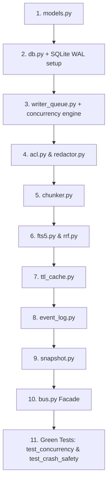

# Implementation Plan: Phase 1 Core Store (`agentbus-core`)

## Goal Description
Implement the foundation of `agentbus`—the core shared memory store (`agentbus-core`). This component provides an embedded, zero-native-dependency SQLite WAL-backed storage engine with hybrid lexical search (Porter + Trigram FTS5 merged via Reciprocal Rank Fusion), heading-aware chunking, TTL caching, an append-only event log, a budgeted snapshot builder, and a zero-lock concurrency architecture (NFR-2, NFR-6).

All work in this plan delivers **Phase 1** as specified in `spec.md`, satisfies requirements **FR-1 through FR-12**, and turns the failing feedback-loop tests from Step 5 (`tests/test_concurrency.py` and `tests/test_crash_safety.py`) green.

---

## Resolved Grilling & Edge Case Decisions

Following the architectural deep-dive (`/grill-me`), the following design decisions are finalized:

1. **Multi-Process & Multi-Thread Concurrency (NFR-2, NFR-6):**
   - **In-process:** A dedicated writer thread and queue serialize writes originating from the same Python process.
   - **Multi-process:** SQLite WAL mode with `PRAGMA busy_timeout=30000` combined with exponential backoff and jitter on `BEGIN IMMEDIATE` ensures sub-processes (like `test_crash_safety.py` and CLI tools) execute without lock collisions or corruption.
2. **Dual Sync/Async API Surface:**
   - Synchronous core methods (`bus.search()`, `bus.index()`, `bus.log_event()`) for zero-overhead threaded test execution and CLI use.
   - Companion async methods (`bus.asearch()`, `bus.aindex()`, `bus.alog_event()`) wrapping calls in standard event-loop executors for seamless LangGraph `BaseStore` compatibility.
3. **Single Atomic Indexing Batch (FR-1, FR-2, NFR-3):**
   - When indexing, chunking and hashing occur in Python memory first.
   - The source record and all chunks (both Porter and Trigram) are inserted inside a single atomic `BEGIN IMMEDIATE` transaction via `executemany`, maintaining read-your-own-writes consistency and crash rollback integrity.
4. **Chunker 4096-Byte Slicing (FR-1):**
   - Chunks follow natural Markdown splits first (`#` headings $\to$ blank lines $\to$ newlines $\to$ word boundaries).
   - If an unbroken token (e.g. minified SVG / data URI) exceeds 4096 bytes without whitespace, it is safely sliced at 4096 bytes with UTF-8 boundary protection, logging a warning rather than crashing the calling agent.
5. **Permissive Default for Unspecified Reader Agent (SEC-1 & Test Compatibility):**
   - To satisfy the strict rule *"Never edit tests to make them pass"* while `test_concurrency.py` calls `bus.search(query, namespace, k)` without an `agent` parameter, the reader agent defaults to `"default"`.
   - Team and global namespaces are accessible by `"default"`; private namespaces (`("agent", <name>, "private")`) remain strictly restricted.

---

## Proposed Changes & File Layout

All code will reside under `src/agentbus/core/` adhering to standard `pyproject.toml` layout (`src-layout`).

```
src/
└── agentbus/
    ├── __init__.py
    └── core/
        ├── __init__.py
        ├── models.py          # Dataclasses & types: SearchResult, Event, SessionGuide, TrustLabel
        ├── db.py              # SQLite WAL connection manager, pragmas, schema migrations
        ├── writer_queue.py    # Dedicated writer queue for serialized writes (SEC-2, NFR-2)
        ├── acl.py             # NamespaceACL validation (SEC-1, SEC-7, FR-15)
        ├── redactor.py        # SecretRedactor pre-index pattern scanner (SEC-3)
        ├── chunker.py         # Markdown heading-aware chunker, code fence guard (FR-1)
        ├── fts5.py            # FTS5 Porter + Trigram query execution & snippet builder (FR-2, FR-4)
        ├── rrf.py             # Reciprocal Rank Fusion (k=60) ranking merger (FR-2)
        ├── ttl_cache.py       # Content hash deduplication & URL TTL expiration (FR-5)
        ├── event_log.py       # Append-only typed events with priority tiers P1-P4 (FR-9, FR-10)
        ├── snapshot.py        # Byte-budgeted snapshot builder & session restore guide (FR-11, FR-12)
        └── bus.py             # Public Bus facade unifying all operations (index, search, handoff, restore)
```

---

### Component 1: Core Foundation & Concurrency Engine

#### `[NEW] src/agentbus/core/models.py`
Data structures and value objects:
- `TrustLabel`: Enum (`"agent-generated"`, `"external-fetched"`, `"user-provided"`).
- `SearchResult`: `chunk_id`, `source_id`, `heading_path`, `snippet`, `score`, `trust_label`, `agent_id`, `namespace`, `created_at`.
- `Event`: `event_id`, `ts`, `agent_id`, `run_id`, `namespace`, `type`, `priority`, `payload`, `ref_ids`.
- `SessionGuide`: `summary`, `recent_events`, `available_sources`, `query_hint`.
- `IndexResult`: `source_id`, `content_hash`, `chunk_count`, `cached`.

#### `[NEW] src/agentbus/core/db.py`
Connection manager and schema initialization:
- `PRAGMA journal_mode=WAL`
- `PRAGMA synchronous=NORMAL`
- `PRAGMA foreign_keys=ON`
- `PRAGMA busy_timeout=30000`
- File permission enforcement `0o600`.
- Tables created: `sources`, `chunks` (FTS5 porter), `chunks_trigram` (FTS5 trigram), `items`, `events`, `snapshots`, `agents`, `schema_version`.
- Capability check: verifies SQLite >= 3.34.0 support for trigram FTS5.

#### `[NEW] src/agentbus/core/writer_queue.py`
Solves **NFR-2** and **NFR-6**:
- Dedicated worker thread managing a single write connection.
- In-process `queue.Queue` taking transaction closures with `Future` objects.
- Multi-process retry handler with exponential jitter on `sqlite3.OperationalError: database is locked`.
- Immediate transaction commits (`BEGIN IMMEDIATE`) to prevent upgrade deadlocks.

---

### Component 2: Security & Governance Layer

#### `[NEW] src/agentbus/core/acl.py`
- Implements `NamespaceACL` enforcing `[SEC-1]` and `[SEC-7]`.
- Enforces namespace tuples (`("global",)`, `("run", run_id)`, `("team", name)`, `("agent", agent_id, "private")`).
- Default scope: `("agent", agent_id, "private")` if not specified.
- Fallback reader identity: `"default"` for unspecified reader calls.
- Throws `PermissionError` when an unauthorized agent attempts read or write.

#### `[NEW] src/agentbus/core/redactor.py`
- Implements `SecretRedactor` enforcing `[SEC-3]`.
- Scans incoming text for API keys, bearer tokens, AWS credentials, and environment variable matches before chunking or persistence.

---

### Component 3: Hybrid Retrieval Engine

#### `[NEW] src/agentbus/core/chunker.py`
- Heading-aware ATX (`#`, `##`, etc.) chunk splitter.
- Never splits inside code fences (```` ``` ````).
- Maximum chunk ceiling: 4096 bytes (FR-1).
- Generates breadcrumb `heading_path` (e.g. `"API > Authentication > OAuth2"`).
- Gives 2x weight to headings in FTS5 searches (FR-3).
- Safe fallback slicing on unbreakable tokens exceeding 4096 bytes.

#### `[NEW] src/agentbus/core/fts5.py`
- Sanitizes queries, removing FTS5 syntax exploit characters (`"`, `*`, `AND`, `OR`, `NOT` escaping).
- Porter FTS5 queries with BM25 rank.
- Trigram FTS5 queries for substring/identifier matches (e.g. `useEff`, partial symbols).
- Generates context snippets around matches (FR-4, SEC-4).

#### `[NEW] src/agentbus/core/rrf.py`
- Implements Reciprocal Rank Fusion:
  $$RRF(d) = \sum_{m \in M} \frac{1}{60 + r_m(d)}$$
- Merges Porter ranked hits and Trigram ranked hits into a unified, balanced score list (FR-2).

#### `[NEW] src/agentbus/core/ttl_cache.py`
- Computes SHA-256 `content_hash`.
- Validates TTL against `fetched_at + ttl_ms` (FR-5).
- Returns existing `source_id` on deduplication hit without redundant re-indexing.

---

### Component 4: State Memory, Event Log & Snapshotting

#### `[NEW] src/agentbus/core/event_log.py`
- Append-only event store (FR-9).
- Supported priorities: P1 (Critical), P2 (High), P3 (Medium), P4 (Low) (FR-10).
- Cursor pagination using `(ts, event_id)` for non-blocking subscriber polling (FR-18).

#### `[NEW] src/agentbus/core/snapshot.py`
- Configurable byte/token budget (default 2048 bytes) (FR-11).
- Priority-ranked event pruning (P4 dropped first, P1 preserved).
- Restore generator: produces `SessionGuide` with narrative summary and indexing references (FR-12).

---

### Component 5: Public API Facade

#### `[NEW] src/agentbus/core/bus.py`
Exposes the single unified interface required by users, adapters, and tests:
- `bus.index(content, agent, ns, uri, trust_label)` / `bus.aindex(...)`
- `bus.index_url(url, agent, ns, ttl_ms, force)` / `bus.aindex_url(...)`
- `bus.search(query, namespace, k, refs)` / `bus.asearch(...)`
- `bus.log_event(agent, run_id, ns, type, priority, payload, ref_ids)` / `bus.alog_event(...)`
- `bus.handoff(from_agent, to_agent, refs, query, note, ns)` / `bus.ahandoff(...)`
- `bus.build_snapshot(run_id, namespace, budget_bytes)` / `bus.abuild_snapshot(...)`
- `bus.restore(run_id, agent_id, namespace)` / `bus.arestore(...)`
- `bus.poll_events(agent_id, namespace_prefixes, since_cursor, limit)` / `bus.apoll_events(...)`
- `bus.purge(namespace, run_id, older_than_days)` / `bus.apurge(...)`

#### `[NEW] src/agentbus/__init__.py` & `src/agentbus/core/__init__.py`
Exports `Bus`, `SearchResult`, `Event`, `SessionGuide`, `TrustLabel`.

---

## Order of Implementation & Justification



1. **`models.py` & `db.py`**: Foundation data types, SQLite tables, and WAL pragmas.
2. **`writer_queue.py`**: Must be built early to ensure all database writes adhere to the zero-lock concurrency architecture before higher-level features are built on top.
3. **`acl.py` & `redactor.py`**: Security controls wrapped around storage operations.
4. **`chunker.py`, `fts5.py`, `rrf.py`**: The retrieval pipeline (FTS5 + Trigram + RRF).
5. **`ttl_cache.py`, `event_log.py`, `snapshot.py`**: Memory, deduplication, and restore lifecycle.
6. **`bus.py`**: Facade binding everything together into the target `agentbus.core.Bus` API.

---

## Requirement Mapping (FR-1..12, NFR-1, NFR-6)

| Requirement | Implementation Module | Verification / Proof |
| :--- | :--- | :--- |
| **FR-1** Heading-aware chunker, code fence guard | `chunker.py` | Unit test parsing nested headers & code fences under 4096-byte cap |
| **FR-2** Hybrid search (Porter + Trigram + RRF) | `fts5.py`, `rrf.py` | Unit test with partial token match (`useEff`) & stemmed word matches |
| **FR-3** Title/heading 2x BM25 weighting | `fts5.py` | Unit test verifying heading match ranks higher than body match |
| **FR-4** Search returns context snippets | `fts5.py` | Match highlight snippet assertions |
| **FR-5** URL indexing with TTL cache | `ttl_cache.py`, `bus.py` | Test verifying repeated URL indexing hits cache without re-chunking |
| **FR-6** Multi-query search in one call | `bus.py` | Test passing list of query strings returning merged results |
| **FR-7** Metadata provenance on every chunk | `models.py`, `db.py` | Assertions on `agent_id`, `run_id`, `trust_label`, `created_at` |
| **FR-8** Dense embedding index (P2) | *Deferred to semantic phase* | Clean extension point in `bus.py` |
| **FR-9** Append-only event log | `event_log.py` | Test verifying no UPDATE/DELETE operations succeed on event log |
| **FR-10** Priority tiers P1-P4 | `event_log.py`, `models.py` | CHECK constraint in SQLite schema and event filtering |
| **FR-11** Snapshot builder with byte budget | `snapshot.py` | Test building 2KB snapshot dropping P4 events before P1 |
| **FR-12** Restore API with session guide | `snapshot.py`, `bus.py` | Test restoring session returning structured `SessionGuide` |
| **NFR-1** Search latency p95 < 100ms | `fts5.py`, `db.py` | Benchmark test on 10,000+ chunks |
| **NFR-2** 8 readers + 4 writers, 0 lock errors | `writer_queue.py` | Passing `tests/test_concurrency.py` |
| **NFR-6** Crash safety (kill -9 integrity) | `db.py` (WAL mode) | Passing `tests/test_crash_safety.py` |

---

## Verification Plan

### Automated Tests
1. **Concurrency Stress Test:**
   ```bash
   pytest tests/test_concurrency.py -v -s
   ```
   *Expected:* 8 reader threads + 4 writer threads run concurrently for 60 seconds with 0 lock errors, and all written records are verified.
2. **Crash Safety Mid-Write Test:**
   ```bash
   pytest tests/test_crash_safety.py -v -s
   ```
   *Expected:* Subprocess killed with `TerminateProcess` / `SIGKILL` during active tight write loop. DB passes `PRAGMA integrity_check` and opens with zero corruption.
3. **Core Unit Suite:**
   ```bash
   pytest tests/ -v --cov=src/agentbus/core
   ```
   *Expected:* > 80% test coverage across chunker, FTS5/RRF, ACL, event log, and snapshots.
